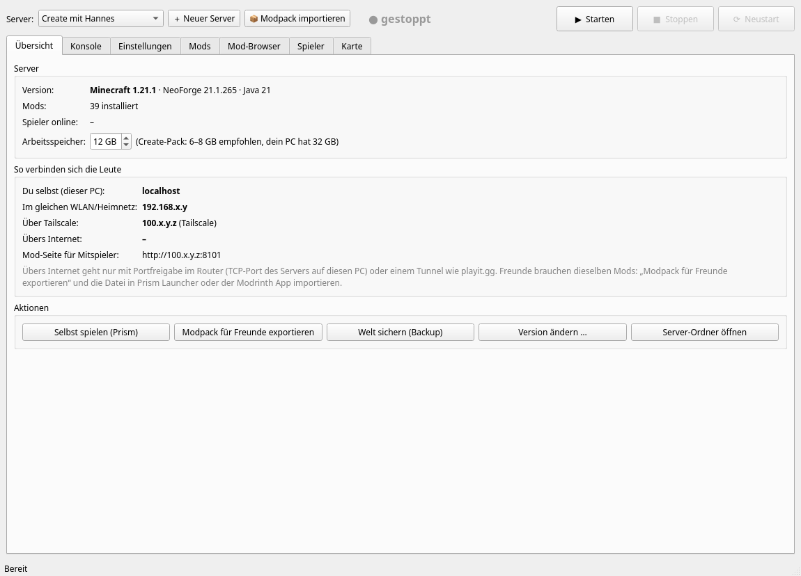
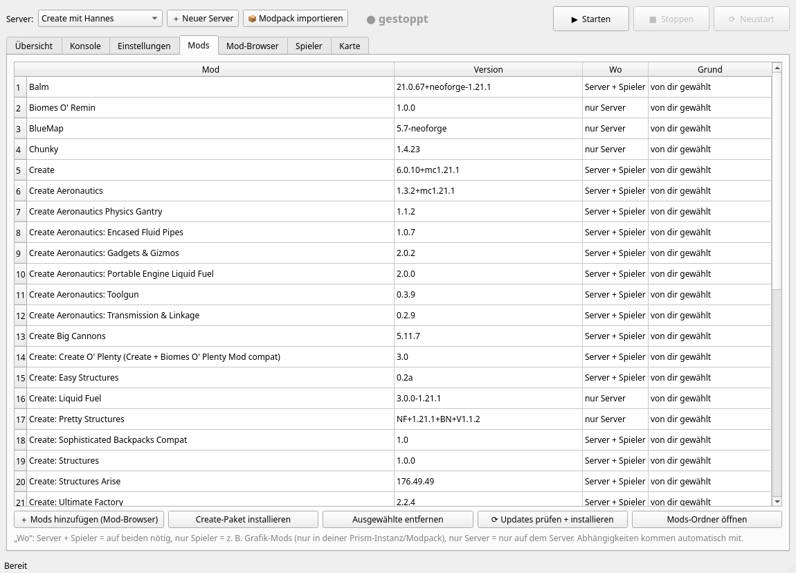
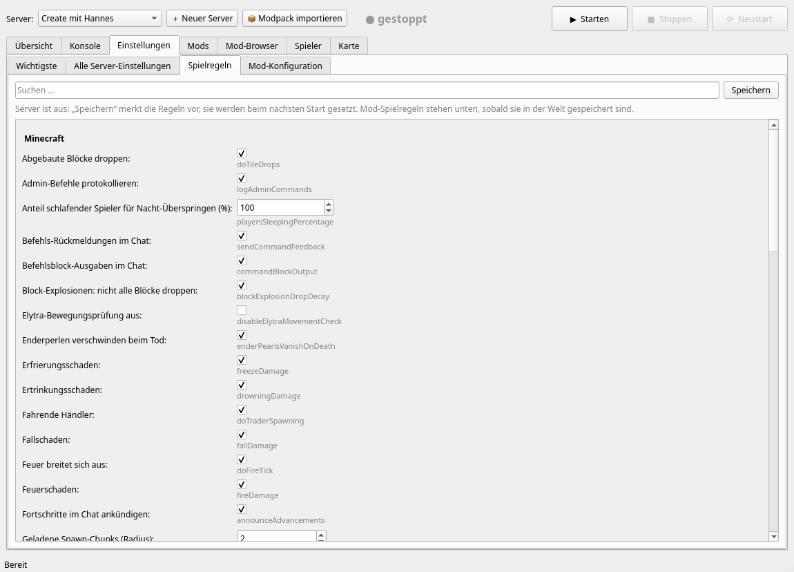
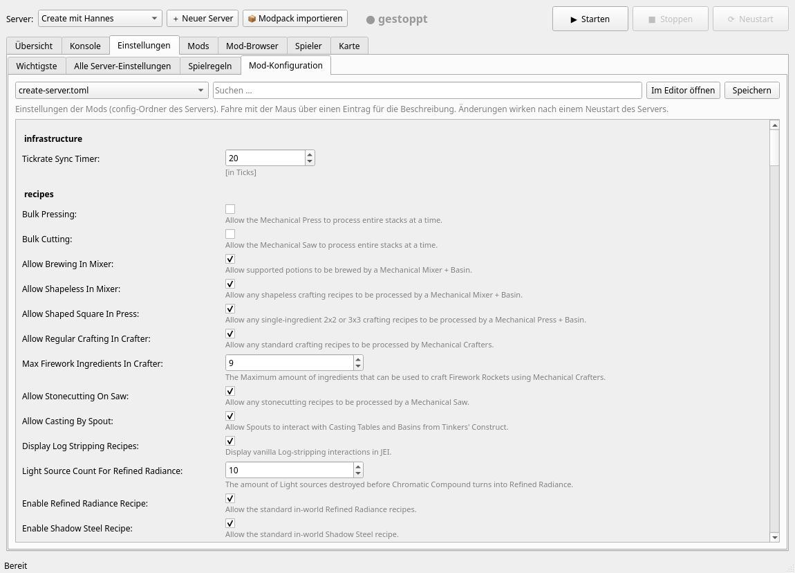
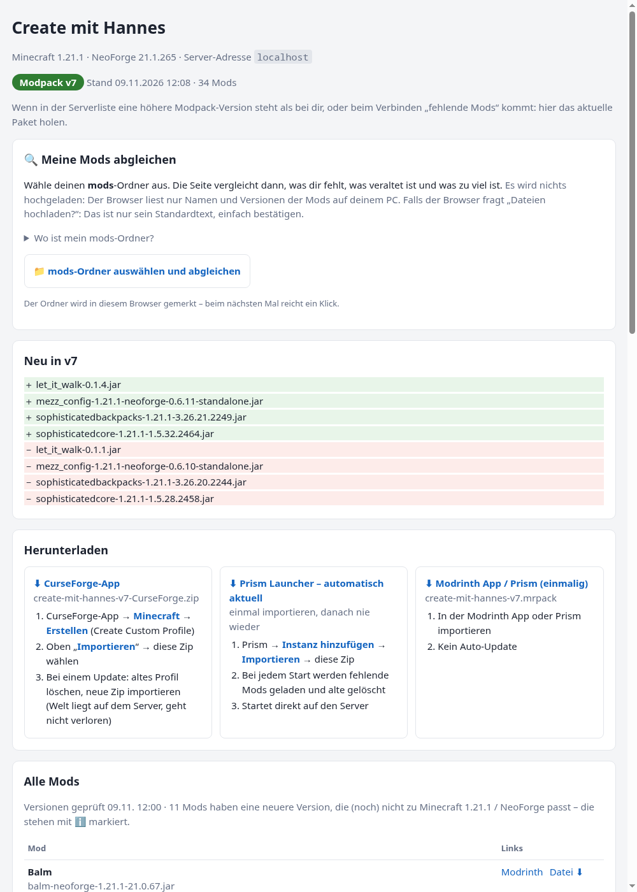

# MC Server Manager

A small desktop tool (Python 3 + PyQt6, Linux) that I use to run a **private, non-commercial Minecraft
server** for my brother and me (Minecraft 1.21.1, NeoForge, Create + addons). The UI is in German.

It is not a public product and has no users besides the two of us.



## What it does

- **Server control**: create servers, install the loader (NeoForge/Forge/Fabric), start/stop/restart,
  console, backups, whitelist/ops, spawn settings.
- **Mods**: browse and install mods that are **compatible with the server** (same Minecraft version and
  mod loader), including required dependencies; detect server-only / client-only mods; one-click
  update check for all installed mods.
- **Settings with checkboxes**: all `server.properties`, all game rules and every mod config file
  (`config/*.toml`) as checkboxes / number fields instead of editing text files.
- **Mod page for players** (small web page, only reachable inside our Tailscale network): shows which
  mods the server needs, the current modpack version, which of your local mods are missing or have
  the wrong version, and newer mod versions that are *not yet* compatible with the server.

| Mods | Game rules | Mod configs |
|---|---|---|
|  |  |  |



## How the CurseForge API is used

The CurseForge API (`api.curseforge.com/v1`) is used only for these read-only calls:

| Endpoint | Purpose |
|---|---|
| `GET /v1/mods/search` | Search mods, always filtered by `gameVersion` and `modLoaderType` of the server |
| `GET /v1/mods/{modId}` | Mod name, logo, links, `allowModDistribution` |
| `GET /v1/mods/{modId}/files` | Pick the newest stable file for the server's Minecraft version + loader, read required dependencies (`relationType = 3`) |
| `POST /v1/mods/featured` | (optional) list of popular mods |

Rules the tool follows:

- **Respects `allowModDistribution`**: if a mod author does not allow third-party downloads, the tool
  does not download the file and instead links to the mod's CurseForge page.
- Files are downloaded once and verified with the SHA-1 hash from the API; every mod links back to its
  CurseForge page so downloads and views go to the authors.
- **No public redistribution.** Mod files are only shared privately between my brother and me (2 players)
  so that we have identical versions on our private server.
- Very low request volume: a handful of calls when I search or update mods, plus one update check per
  installed mod every few hours (~40 mods).
- Older parts of the tool (importing CurseForge modpack zips, update check for mods that came from such a
  zip) still read file info from the public curseforge.com download endpoints; these will be moved to the
  official API.
- The API key is stored locally in `~/MinecraftServer/curseforge-api-key.txt` (file mode 600) and is
  **never** part of this repository.

## Files

| File | Content |
|---|---|
| `mcserver_gui.py` | Main window (PyQt6) |
| `mcserver_core.py` | Logic: servers, loaders, mods, CurseForge/Modrinth API, modpack export/import |
| `einstellungen.py` | Settings editors (server.properties, game rules, mod configs) |
| `modseite.py` | Mod page for players (built-in HTTP server, port 8101) |
| `mobs.py`, `bluemap/` | Extras for the BlueMap web map (player and mob models) |

## Running

```bash
pip install PyQt6 PyQt6-WebEngine   # or the distro packages
python3 mcserver_gui.py
```

Data lives in `~/MinecraftServer/` (servers, Java runtimes, mod cache, backups).

## License

MIT – see [LICENSE](LICENSE). Minecraft is a trademark of Mojang/Microsoft; this project is not
affiliated with Mojang, Microsoft, CurseForge or Overwolf.
